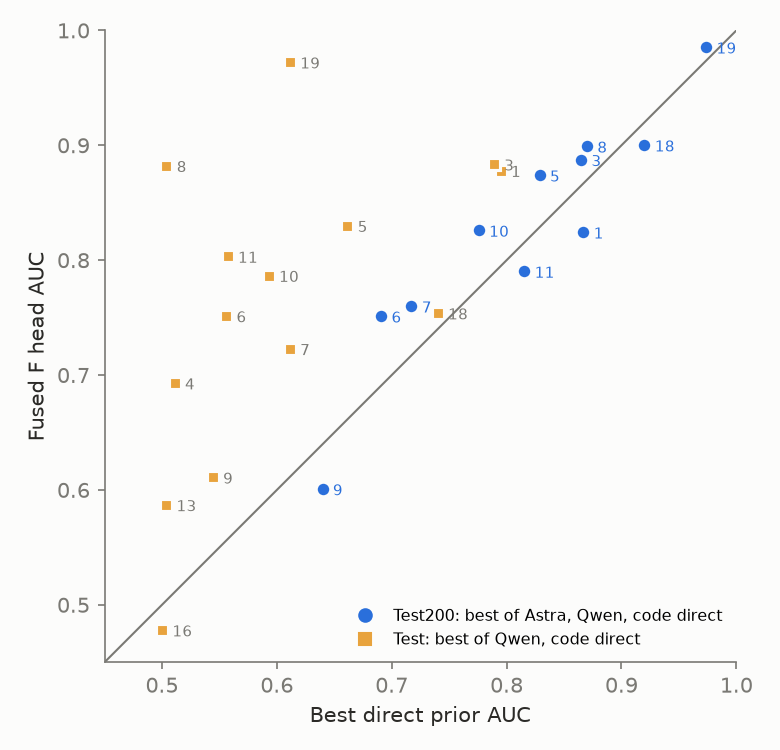

# AH: agent-built heads on Prithvi, no human labels (AH-0 to AH-4)

**H1 fails, H2 fails, and Prithvi adds as a learner.**
- **H1.** On the 12 H1 classes of Test200, the fused F head beats the best direct prior by only +0.012 AUC [−0.013, +0.037].
- **Against the weaker priors.** On full Test it beats Qwen direct and code direct by +0.174 [0.162, 0.186].
- **H2.** Fused labels lose to the best single source: the fused F head trails the Astra-label F head by −0.077 [−0.090, −0.062]. Dawid-Skene with two informative sources mostly sides with Qwen's low yes-rate, which throws away Astra's recall.
- **Substrate.** With the same fused labels, F beats the VC text substrate by +0.047 [0.029, 0.064] and the physics descriptors by +0.048 [0.033, 0.062].
- **Free agent.** It beats the fixed recipe by +0.082 [0.067, 0.095].

## Deviations

| ID | What | Why | Effect |
|---|---|---|---|
| — | No change requests. Design followed as written. | | |
| Class 14 has no fused head (not covered by the design) | Dawid-Skene put the prior for transitional woodland at 0.016, above the 0.01 fallback line, and no bank patch reached P ≥ 0.5. | The fused label has 0 positives, so no head can be trained. | Class 14 is left out of every mean that needs a fused head (14 classes for H2, substrate and free agent; 11 of 12 for H1). |
| Bank n = 497 | 3 bank captions failed twice and were dropped, as the design says. | | Every source, fusion and head uses 497 patches. The free-agent prompt says 500. |
| Test200 n = 199 | The stage 1 Test200 that lies inside Test. | One patch was dropped by VS. | None. |
| Free-agent audit | th_common.codex_call flags every file_change item. Under workspace-write the design allows writes in the workspace, so the flag is dropped only when every changed path lies inside the workspace. | The design's workspace-write sandbox. | Call 2 wrote predict.py and method.md in its workspace; no read outside it. |
| Anonymous test ids | test_ids.json holds t0000–t0996, not BigEarthNet names. | Keeps patch names, which carry tile and date, out of the workspace. | None on scoring. |
| AH-E1 (fixed before the final run) | The mean label value compared a 14-class fused mean with a 15-class reference curve. | My code bug. | Both now use the same classes. |
| AH-E2 (fixed) | Adding the report-only extras crashed the measures step on a class index. | My code bug. | No output was written by the crashed run. |

Placement: B2 timed out on ssh again, so the captions ran on A2.

## Headlines
- **H1 (expansion): fails.**
  - On the 12 H1 classes of Test200, the mean AUC of the fused F head is 0.827. The best direct prior per class has a mean of 0.815, almost always Astra. The difference is +0.012 [−0.013, +0.037].
  - On full Test, against the priors that exist there, it gains +0.175 [0.164, 0.187] over Qwen direct and +0.290 [0.280, 0.301] over code direct.
- **H2 (amplification): fails.** Over 14 classes, the fused F head (mean 0.759) trails the best single-source F head (0.832, the Astra head) by −0.077 [−0.090, −0.062]. It wins only on urban fabric, pastures and agriculture with natural vegetation, each by about +0.01 and none with a CI above 0.
- **Substrate: Prithvi adds as a learner.** With the same fused labels, mean AUC is 0.759 for F, 0.713 for VC and 0.712 for D.
- **Free agent: beats the recipe.** Mean AUC 0.842, or +0.082 [0.067, 0.095] over the fused F head. It is better on 11 of 14 classes. It is worse on 3, and only broad-leaved forest (−0.037) has a CI below 0.
- **Label value.**
  - The fused F head is worth 30 true labels or fewer on average: a 30-label head scores 0.782.
  - Per class it is worth 54 to 340 labels on the agricultural, urban and mixed forest classes, and 30 or fewer on 7 classes.
- **Report only (not design measures).**
  - The Astra-label F head beats the best direct prior on Test200 by +0.023 [0.004, 0.044].
  - The free agent beats it by +0.021 [0.006, 0.039].
  - So the H1-style gain exists without fusion. It is the fusion that removes it.

Blue circles are Test200 against the best of Astra, Qwen and code direct; points above the diagonal are H1 gains. Orange squares are full Test against the best of Qwen and code direct.

## Per-class AUC (Test, 997 patches, unless marked T200)

| Class | Test pos | Astra direct (T200) | Fused F (T200) | Qwen direct | Code direct | Astra head F | Qwen head F | Fused F | Fused VC | Fused D | Free agent | True 30 | True 100 | True 500 | Labels equivalent |
|---|---|---|---|---|---|---|---|---|---|---|---|---|---|---|---|
| 1 Urban fabric | 96 | .867 | .824 | .795 | .504 | .870 | .867 | .878 | .854 | .751 | .898 | .694 | .804 | .901 | 340 |
| 3 Arable land | 420 | .865 | .887 | .789 | .506 | .894 | .861 | .883 | .839 | .816 | .892 | .808 | .890 | .918 | 90 |
| 4 Permanent crops | 34 | (.686) | .757 | .511 | .504 | .888 | .737 | .693 | .601 | .600 | .880 | .793 | .847 | .869 | ≤ 30 |
| 5 Pastures | 217 | .829 | .874 | .661 | .504 | .811 | .821 | .830 | .749 | .787 | .824 | .781 | .840 | .896 | 82 |
| 6 Complex cultivation | 178 | .691 | .751 | .556 | .504 | .792 | .704 | .751 | .662 | .602 | .778 | .667 | .725 | .818 | 157 |
| 7 Agri. with natural veg. | 236 | .717 | .760 | .611 | .505 | .710 | .699 | .723 | .682 | .579 | .707 | .639 | .707 | .779 | 143 |
| 8 Agro-forestry † | 78 | .870 | .899 | .491 | .504 | .943 | — | .882 | .678 | .886 | .952 | .910 | .962 | .977 | ≤ 30 |
| 9 Broad-leaved forest | 299 | .640 | .601 | .544 | .505 | .587 | .638 | .611 | .561 | .538 | .574 | .708 | .802 | .841 | ≤ 30 |
| 10 Coniferous forest | 322 | .776 | .826 | .593 | .505 | .871 | .759 | .787 | .754 | .739 | .868 | .875 | .910 | .924 | ≤ 30 |
| 11 Mixed forest | 365 | .815 | .790 | .557 | .506 | .835 | .759 | .803 | .733 | .715 | .833 | .779 | .829 | .893 | 54 |
| 13 Moors, heathland † | 27 | (.675) | .406 | .480 | .504 | .860 | — | .587 | .659 | .698 | .869 | — | .837 | .932 | > 500 |
| 14 Transitional woodland | 325 | .816 | — | .507 | .505 | .737 | — | — | — | — | .744 | .671 | .731 | .800 | > 500 |
| 16 Inland wetlands † | 31 | (.795) | .276 | .499 | .500 | .764 | — | .478 | .476 | .492 | .807 | .734 | .602 | .874 | ≤ 30 |
| 18 Inland waters | 124 | .920 | .900 | .740 | .568 | .823 | .732 | .754 | .790 | .763 | .904 | .785 | .812 | .897 | ≤ 30 |
| 19 Marine waters | 99 | .974 | .985 | .611 | .571 | .996 | .819 | .972 | .938 | .996 | .996 | .993 | .994 | .999 | ≤ 30 |
| **Mean of 14 (no class 14)** | | | | **.603** | **.513** | **.832** | **.763** | **.759** | **.713** | **.712** | **.842** | **.782** | **.826** | **.894** | **≤ 30** |

- **Symbols.**
  - † marks a class where Dawid-Skene fell back to the majority vote (prior below 0.01).
  - Parentheses mark classes with fewer than 10 positives in Test200, which are not H1 classes.
  - "—" means no head: fewer than 10 yes answers for a Qwen head, or no fused positives for class 14. For the 30-label reference, no seed drew a positive.
- **References.** "True n" columns are heads trained on n true bank labels, averaged over seeds 0–2. Labels equivalent interpolates the fused F AUC on that curve in log n.
- **Code source.** Neither code column has a head: the code rules never say yes, so no code head was trainable.
- **H1 means on Test200 (12 classes).** Fused F 0.827; Astra direct 0.815; Qwen direct 0.608; code direct 0.519; Astra head 0.838; free agent 0.836.

## Sources and fusion
- **Code rules (Astra call 1).**
  - The rules are exclusion-only, as in stage 1. They never say yes.
  - They say no to land classes on uniform open water, and no to the water classes under strong vegetation or SWIR reflectance. Otherwise they abstain.
  - Coverage on the bank is 0.03 for land classes and 0.12 for classes 18 and 19. Code direct AUC is about 0.50.
- **Dawid-Skene with two informative sources.**
  - Astra over-calls (bank yes-rate 0.47 on coniferous against a true 0.31). Qwen under-calls (0.06).
  - EM settles on the high-specificity, low-prior solution: fused yes-rates of 0.06 on coniferous (true bank rate 0.31), 0.05 on mixed forest (0.34) and 0.00 on transitional woodland (0.26).
  - It does not converge within 200 iterations on 9 classes, and falls back to the majority vote on 3 (8, 13, 16).
  - The weighted labels then keep few positives, and the heads learn a narrower concept than either teacher.
- **Trust (report only).**
  - The estimated accuracy of each source (mean of sensitivity and specificity) ranks sources like their true balanced accuracy on the bank: Spearman 0.77 over 31 class × source pairs.
  - Per class only 2 sources score, so each per-class value is ±1. They agree (+1) on 10 of 15 classes.
  - Dawid-Skene does know which source is better. The prior, not the source weights, is what goes wrong.

## Free agent (Astra call 2)
- **What it did.** It used only its workspace (9 commands, 193 s, audit clean). It wrote `predict.py` (saved in raw/a2_free_try1).
- **Its method.**
  - It turned Astra's bank answers into soft targets by confidence: yes at 0.97, 0.80 or 0.57, and no at 0.015, 0.10 or 0.28.
  - It fitted linear and RBF kernel ridge and extra-trees regressors on F, D, Qwen answers and caption TF-IDF.
  - It stacked them with out-of-fold nonnegative weights fitted against those soft targets.
- **Why it wins.** It keeps Astra as the teacher, which this run's H2 shows is the stronger single source, and it uses its confidence. It does not vote Astra down with Qwen.

## Cost

| Source or condition | Astra calls | Wall time | GPU minutes |
|---|---|---|---|
| Astra answers, bank (stage 1, reused) | 100 | about 25 min at concurrency 3 | 0 |
| Astra direct, Test200 (stage 1, reused) | 40 | about 10 min | 0 |
| Qwen answers, bank and Test (stage 1, reused) | 0 | 414 s + 836 s | 21 (A2) |
| Code rules (new) | 1 | 171 s call + 2 s apply | 0 |
| F: Prithvi, bank (new; Test reused from VS) | 0 | 8 s + model load | < 1 (host A) |
| VC: captions + fields + embeddings, bank (new; Test reused from VS, about 50 min of A2 captioning) | 0 | 1,504 s + 104 s | 27 (25 on A2, 2 on host A) |
| D: descriptors | 0 | 1 s CPU | 0 |
| Fusion, 197 heads, references, bootstrap | 0 | 41 s CPU, 12 jobs | 0 |
| Free agent (new) | 1 | 193 s | 0 |
| **New in AH** | **2 of 4** | **about 50 min** | **about 28** |

**Per condition.**
- **Fused F head:** the 100 bank Astra calls, the Qwen bank pass, 1 code call and Prithvi.
- **Fused VC:** adds the bank captions and embeddings.
- **Fused D:** adds only the descriptors.
- **Free agent:** all inputs plus 1 call.
- **Astra direct on all of Test** would need about 160 more calls; the heads need none per patch.

## Reading the result
- **Fusion is the weak link, not the learner.** Prithvi trained on Astra's labels alone beats every direct prior on Test200, including Astra itself (report only, +0.023). Dawid-Skene fusion then lowers that head by 0.077.
  - With one strong source and one weak source plus a code source that only abstains, the model cannot identify the class prior.
  - EM picks the solution in which the conservative source is right.
- **Prithvi matters as a learner.** Under identical labels, F beats both text embeddings and physics numbers by about 0.05 AUC. This repeats VS's finding with labels from priors instead of truth.
- **Open agency beats the fixed recipe here, by about 0.08 AUC.** But it mostly does so by distilling Astra well. Its own Test200 gain over the best prior (+0.021) equals the Astra head's (+0.023).
- **Label value is low.** On average the fused F head equals fewer than 30 true labels. Even the Astra head (mean 0.832) sits just above the 100-label reference (0.826) and well below the 500-label one (0.894).
- **Limits.**
  - Test200 holds 13–14 positives for urban fabric and agro-forestry, so single-class CIs there are wide.
  - Class 14 has no fused head.
  - The code source added nothing, so "fusion" here is effectively two VLMs.

## Files
- **Design and log:** `DESIGN_AH_v1.md` (sha256 ad5b869b…) and `LOG.md`.
- **Calls:** `calls.jsonl` (ledger) and `raw/` (events, commands, last messages; scores.npy, method.md and predict.py for call 2).
- **Code rules:** `code_rules.json`, `code_rules.py` and `code_apply.json`.
- **Scripts:** `scripts/ah_common.py`, `ah1.py`, `ah2.py` and `ah3.py`, 453 lines in all.
- **Inputs:** `workspaces.json` (file lists and label checks) and `fields_bank.jsonl`.
- **Results:** `ah3.json`, which holds all AUCs, CIs, Dawid-Skene parameters, references, label value and trust, and `figs/fused_vs_prior.png`.
- **Kept outside the repo:** bank captions, layers, embeddings, descriptors, workspaces, fused labels and test scores are in `~/langres_state/ah/`.
