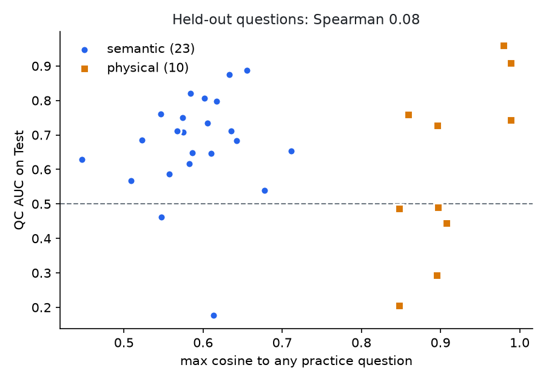
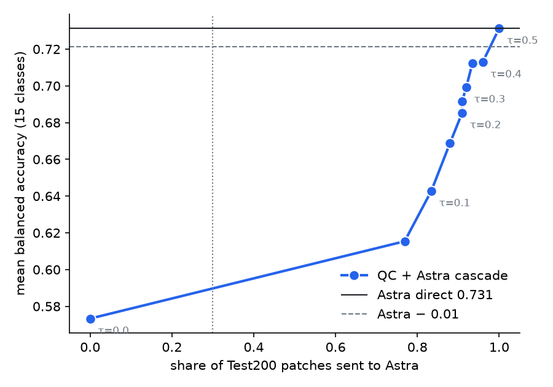

# QC: question-conditioned head on Prithvi (QC-0 to QC-4)

## Deviations
| Id | What | Effect |
|---|---|---|
| QC-X1 (approved) | The question-writing call was voided 3 times (q001–q003) because Astra read the host Codex skill `~/.codex/skills/qa-ladder` (a tool use). The approved flag `--enable skip_host_skill_discovery` had no effect (q003). | Flag removed again. With the user's go-ahead the skill and its 5 `.bak` copies were moved to `~/.codex/skills_off/`; q005 then ran with the frozen settings. |
| Call q004 | My error: I retried before checking that the skill was gone. It was still there and q004 was voided. | One wasted call. |
| Calls | 127 used (planned 123, cap 140): 5 question calls (4 voided), 4 order-check calls, 118 main calls. All 122 answer calls were valid on the first try. | None on the data. |
| Implementation | G1–G8 derived from scores: OR = max, AND = min, "more than three" = 4th-largest member score. On yes/no answers this is the stage 1 rule. | Used for Astra direct, Qwen direct and the reference heads on G. |
| Implementation | Cascade "share of Astra calls" counts a Test200 patch as sent to Astra when any of its 15 class answers is deferred (one call answers all classes). The share of deferred answers is also reported. | The verdict uses the patch share. |
| Implementation | CV, temperature and calibration use log loss weighted by the sample weights (\|2P − 1\| for soft labels, 1 for code keys). | – |
| Skipped by rule | P1_5_bottom (water share in the bottom quarter; the 25th percentile is 0, so never yes) and A113 (fewer than 10 of one answer). | 139 answerers. |
| Not applicable | The leakage filter dropped nothing (maximum cosine 0.71). | 120 of 150 questions used, in Astra's order. |

## Verdicts
**R1 passes:** on the 23 held-out semantic questions, QC's mean AUC beats the label-free language route by +0.031 [0.015, 0.048] (0.672 against 0.641), and it is higher on 19 of 23 questions. **R2 fails:** QC reaches 0.816 of the per-question Astra reference heads (0.672 against 0.824), short of 0.9; the CI of QC − 0.9 × ref is [−0.079, −0.059]. **Cost fails:** no τ sends at most 30% of Test200 patches to Astra and stays within 0.01 of Astra direct (mean balanced accuracy 0.731). QC alone (τ = 0) gives 0.573, and any τ ≥ 0.05 already sends 77% of patches to Astra because at least one of a patch's 15 answers is uncertain.

## What happened
- **The formula transfers some meaning.** Leave-one-question-out AUC on the practice questions averages 0.783. That is 0.856 on the 119 Astra-written questions but 0.352 on the 20 physical ones.
- **Polarity is the main failure.** The embedding barely separates opposite questions: "top quarter" and "bottom quarter" of a descriptor have cosine ~0.9, so the formula gives them similar answerers although their answers are opposite. Seven held-out questions score below 0.5 (C8, C19, P1_6_bottom, P1_9_top, both P2 moisture contrasts, P3_ndmi). The clearest cases:
  - P1_6_bottom 0.29 and P3_ndmi 0.20. Their nearest practice questions are NDWI bottom (0.90) and "brighter in SWIR 1 than predicted" (0.85), which is physically the opposite of moister.
  - Marine waters (C19) 0.18 and open water (G4) 0.54, while every labeled route scores 0.89 or more. Their nearest practice questions are a water-boundary question (A106) and the NDWI top and bottom pair.
- **Where QC works,** it is close to the labeled routes. G3 built-up 0.887 is above its reference head (0.872) and above Astra direct (0.875). G2 farmland is 0.875, C3 arable 0.821 and C18 inland waters 0.807.
- **Labels equivalent:** QC is worth 30 true labels or fewer on 15 of 23 questions, 30–100 on 7 and 100–300 on 1 (G3).
- **Generalization curve:** QC AUC does not track similarity to the practice set. Spearman is 0.08 over all 33 questions and 0.22 over the 23 semantic ones. Physical questions are the most similar (cosine 0.85–0.99) yet the least reliable.
- **Calibration:** QC is worse calibrated than the reference heads (ECE 0.19 against 0.15 on semantic questions, 0.16 against 0.05 on physical ones).

## Per-question AUC (Test, 997 patches; Astra direct on Test200)
Ref head: Prithvi head trained on stage 1 Astra bank answers (classes, G) or code keys (physical) on Practice. True n: Prithvi heads on n true labels, mean of 3 seeds. Labels equiv.: true-label sample size QC matches.

| Question | QC | Language | Ref head (Astra or code) | Qwen direct | Astra direct (T200) | True 30 | True 100 | True 300 | Max cos | Labels equiv. |
|---|---|---|---|---|---|---|---|---|---|---|
| C1 Urban fabric | 0.798 | 0.740 | 0.877 | 0.795 | 0.867 | 0.767 | 0.827 | 0.894 | 0.62 | 30-100 |
| C3 Arable land | 0.821 | 0.749 | 0.887 | 0.789 | 0.865 | 0.839 | 0.859 | 0.910 | 0.58 | <=30 |
| C4 Permanent crops | 0.648 | 0.516 | 0.878 | 0.511 | 0.686 | 0.732 | 0.794 | 0.856 | 0.59 | <=30 |
| C5 Pastures | 0.708 | 0.676 | 0.792 | 0.661 | 0.829 | 0.813 | 0.846 | 0.890 | 0.57 | <=30 |
| C6 Complex cultivation patterns | 0.712 | 0.647 | 0.776 | 0.556 | 0.691 | 0.675 | 0.741 | 0.768 | 0.64 | 30-100 |
| C7 Land principally occupied by agriculture, with signific | 0.646 | 0.567 | 0.714 | 0.611 | 0.717 | 0.648 | 0.701 | 0.754 | 0.61 | <=30 |
| C8 Agro-forestry areas | 0.462 | 0.383 | 0.947 | 0.491 | 0.870 | 0.946 | 0.962 | 0.977 | 0.55 | <=30 |
| C9 Broad-leaved forest | 0.587 | 0.567 | 0.586 | 0.544 | 0.640 | 0.735 | 0.820 | 0.845 | 0.56 | <=30 |
| C10 Coniferous forest | 0.760 | 0.723 | 0.886 | 0.593 | 0.776 | 0.851 | 0.871 | 0.913 | 0.55 | <=30 |
| C11 Mixed forest | 0.750 | 0.718 | 0.829 | 0.557 | 0.815 | 0.765 | 0.831 | 0.868 | 0.57 | <=30 |
| C13 Moors, heathland and sclerophyllous vegetation | 0.616 | 0.687 | 0.858 | 0.480 | 0.675 | 0.380 | 0.807 | 0.920 | 0.58 | 30-100 |
| C14 Transitional woodland, shrub | 0.711 | 0.636 | 0.721 | 0.507 | 0.816 | 0.678 | 0.745 | 0.804 | 0.57 | 30-100 |
| C16 Inland wetlands | 0.685 | 0.621 | 0.775 | 0.499 | 0.795 | 0.698 | 0.773 | 0.866 | 0.52 | <=30 |
| C18 Inland waters | 0.807 | 0.726 | 0.799 | 0.740 | 0.920 | 0.773 | 0.827 | 0.863 | 0.60 | 30-100 |
| C19 Marine waters | 0.177 | 0.482 | 0.998 | 0.611 | 0.974 | 0.993 | 0.994 | 0.999 | 0.61 | <=30 |
| G1 Is any forest present? | 0.734 | 0.732 | 0.874 | 0.752 | 0.852 | 0.876 | 0.916 | 0.935 | 0.61 | <=30 |
| G2 Is any farmland present? | 0.875 | 0.784 | 0.927 | 0.803 | 0.885 | 0.879 | 0.909 | 0.954 | 0.63 | <=30 |
| G3 Is any built-up land present? | 0.887 | 0.744 | 0.872 | 0.789 | 0.875 | 0.764 | 0.824 | 0.890 | 0.66 | 100-300 |
| G4 Is any open water present? | 0.539 | 0.666 | 0.926 | 0.693 | 0.892 | 0.887 | 0.926 | 0.943 | 0.68 | <=30 |
| G5 Is any wetland present? | 0.629 | 0.609 | 0.775 | 0.498 | 0.792 | 0.698 | 0.773 | 0.866 | 0.45 | <=30 |
| G6 Is any natural open land present, such as grassland, he | 0.567 | 0.616 | 0.768 | 0.506 | 0.805 | 0.630 | 0.748 | 0.809 | 0.51 | <=30 |
| G7 Does the patch mix farmland with forest, wetland or nat | 0.683 | 0.624 | 0.784 | 0.633 | 0.786 | 0.660 | 0.809 | 0.850 | 0.64 | 30-100 |
| G8 Does the patch contain more than three land cover types | 0.654 | 0.527 | 0.699 | 0.583 | 0.682 | 0.642 | 0.677 | 0.725 | 0.71 | 30-100 |
| P1_6_top Is the patch's moisture (NDMI) in the top quarter of pa | 0.728 | 0.522 | 0.988 | – | – | – | – | – | 0.90 | – |
| P1_6_bottom Is the patch's moisture (NDMI) in the bottom quarter of | 0.294 | 0.568 | 0.991 | – | – | – | – | – | 0.90 | – |
| P1_8_top Is the patch's shortwave infrared 2 brightness in the t | 0.960 | 0.615 | 0.999 | – | – | – | – | – | 0.98 | – |
| P1_8_bottom Is the patch's shortwave infrared 2 brightness in the b | 0.743 | 0.477 | 0.998 | – | – | – | – | – | 0.99 | – |
| P1_9_top Is the patch's near-infrared texture in the top quarter | 0.487 | 0.517 | 0.965 | – | – | – | – | – | 0.85 | – |
| P1_9_bottom Is the patch's near-infrared texture in the bottom quar | 0.758 | 0.473 | 0.963 | – | – | – | – | – | 0.86 | – |
| P2_moister_lr Is the left half moister than the right half? | 0.444 | 0.502 | 0.579 | – | – | – | – | – | 0.91 | – |
| P2_moister_tb Is the top half moister than the bottom half? | 0.490 | 0.474 | 0.621 | – | – | – | – | – | 0.90 | – |
| P3_ndmi Is the patch moister than its visible and near-infrared | 0.205 | 0.467 | 0.933 | – | – | – | – | – | 0.85 | – |
| P3_b12 Is the patch brighter in shortwave infrared 2 than its  | 0.909 | 0.549 | 0.967 | – | – | – | – | – | 0.99 | – |
| **Mean, 23 semantic** | **0.672** | 0.641 | 0.824 | 0.618 | 0.804 (QC on T200 0.674) | 0.753 | 0.825 | 0.874 | | |

## Generalization curve

## Cascade on Test200 (15 classes)

| τ | Mean BA | Share of patches to Astra | Share of answers to Astra |
|---|---|---|---|

| 0.00 | 0.573 | 0.00 | 0.00 |
| 0.05 | 0.615 | 0.77 | 0.18 |
| 0.10 | 0.643 | 0.83 | 0.35 |
| 0.15 | 0.669 | 0.88 | 0.50 |
| 0.20 | 0.685 | 0.91 | 0.63 |
| 0.25 | 0.692 | 0.91 | 0.74 |
| 0.30 | 0.699 | 0.92 | 0.83 |
| 0.35 | 0.712 | 0.93 | 0.88 |
| 0.40 | 0.713 | 0.96 | 0.91 |
| 0.45 | 0.731 | 1.00 | 0.96 |

Astra direct: 0.731.

## Calibration (Test, mean over questions)
| Model | ECE, 23 semantic | Brier, 23 semantic | ECE, 10 physical | Brier, 10 physical |
|---|---|---|---|---|

| qc | 0.193 | 0.177 | 0.164 | 0.218 |

## Settings
- Practice: 300 of the 497 AH bank patches (seed 0). F: blocks 6, 12, 18 and 24 mean-pooled (4,096), standardized on Practice.
- Answerers: logistic, C = 0.01, picked by mean 5-fold CV log loss across questions (0.328 against 0.405 and 0.574).
- Formula: ridge with intercept, alpha = 0.316 (leave-one-question-out mean AUC 0.783).
- Temperature: T = 1.86.
- Astra: gpt-6-astra through Codex 0.164.0 with the stage 1 image-QA settings. Order check: 0.913 agreement over 600 answers.
- Embeddings: Qwen3-Embedding-4B 5cf2132…
- Files: questions.json, physical.json, answers.jsonl, calls.jsonl, raw/, qc3.json, qc4.json, LOG.md and scripts/ (qc_common.py, qc0–qc4.py).
