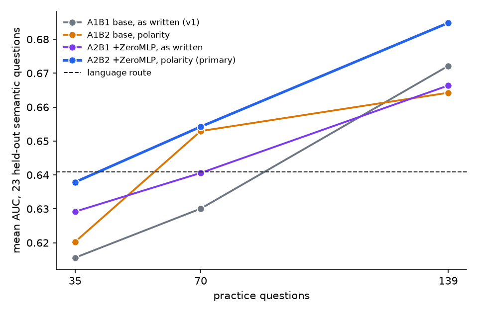
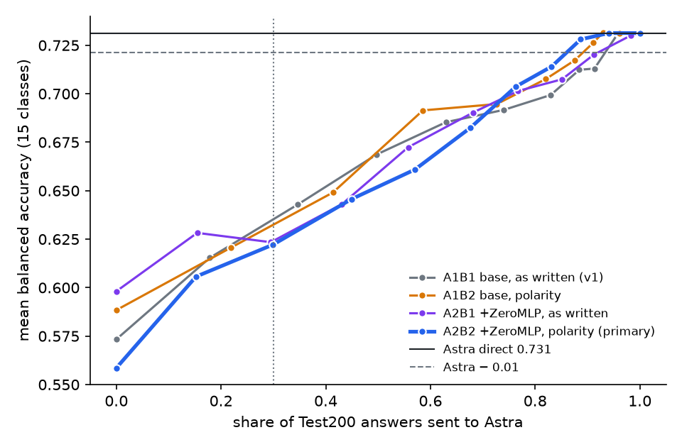

# QV: polarity rewrite and ZeroMLP on the question-conditioned head (QV-0 to QV-4)

## Deviations
| Id | What | Effect |
|---|---|---|
| QV-E1 | My bug: `practice_targets` passed only the 139 fitted questions to v1's `practice_labels`, which finds a soft-label column by position within the list it is given. A114–A120 got their neighbour's labels. | Found because the replication check passed on AUC while T differed (1.877 against 1.864). Fixed, and every fit rerun. After the fix A1B1 matches v1 to 2e-15 on every probability. |
| Coverage | I rewrote 174 questions, not 172: the 2 practice questions v1 skipped (A113, P1_5_bottom) were added so that all 31 physical signs could be checked. | Neither enters any fit. |
| Implementation | B2 uses one alpha for both ridges. A negation triple uses its source's e⁺ with sign −s (its positive form is the source's). | – |
| Implementation | The ZeroMLP's Q projection starts at PCA of the training u's, which have at most n − 1 informative directions (132–138 at 139 questions). The rest of the 256 are filled with random orthonormal directions. | Logged per run (q_rank in fit_*.json). |
| Implementation | The base ridge is refit inside each early-stopping fold. A1's T comes from LOQO, as in v1; A2's from the 5-fold out-of-fold logits, averaged over seeds on the logit scale. | – |
| Calls | No Astra or Codex calls. Qwen3.5-9B on node A2 for the rewrites, 36 s. | $0. |

## Verdicts (primary condition A2 × B2)
**R1 passes:** A2B2 beats the language route by +0.044 [0.029, 0.060] (0.685 against 0.641), up from v1's +0.031. **R2 fails:** 0.831 of the reference heads, against 0.816 in v1; the threshold is 0.9. **Cost fails:** per answer, no τ sends at most 30% of answers to Astra and stays within 0.01 of Astra direct (0.731). At 30% A2B2 reaches 0.622. **More data likely pays off:** from 70 to 139 practice questions A2B2 rises by +0.031 [0.024, 0.037], above the 0.01 bar, and every condition is still rising at 139.

## What happened
- **Neither fix helps alone; together they help a little.** Polarity alone (A1B2) changes mean AUC by −0.008 and the MLP alone (A2B1) by −0.006. Together (A2B2) they add +0.013 [0.005, 0.021] over v1. A2B2 beats v1 on 14 of 23 semantic questions.
- **The polarity rewrite fixes pair consistency, not direction.**
  - Where the embedding knows the property's direction, the rewrite works: SWIR 2 "bottom quarter" goes from 0.743 to 0.981.
  - Where it does not, the rewrite makes a pair consistently wrong: moisture top falls from 0.728 to 0.270, and bottom stays inverted at 0.351.
  - The text encoder places "moisture high" near "SWIR high", which is physically the opposite. Seven held-out questions are still below 0.5 in A2B2, as in v1. The physical mean drops from 0.602 to 0.583.
- **Marine waters improves but is still inverted:** 0.177 in v1, 0.438 in A2B2.
- **Describing a patch.** All four conditions rank questions better than the language route (0.684). The v1 formula is best at 0.761; A2B2 gets 0.751.
- **Calibration:** no condition approaches the reference heads.

## 2 × 2: mean AUC on the 23 held-out semantic questions (Test)
| | B1 as written | B2 polarity |
|---|---|---|
| **A1** base | 0.672 [0.659, 0.685] | 0.664 [0.651, 0.677] |
| **A2** base + ZeroMLP | 0.666 [0.653, 0.679] | 0.685 [0.672, 0.697] |

Language route 0.641; reference heads 0.824; v1 0.672.

## Verdicts and checks by condition
| Condition | R1: minus language | R1 | R2 ratio | R2 | Held-out below 0.5 | Physical mean | Describe: per-patch AUC |
|---|---|---|---|---|---|---|---|
| A1B1 | +0.031 [+0.015, +0.048] | pass | 0.816 | fail | 7 | 0.602 | 0.761 [0.751, 0.770] |
| A1B2 | +0.023 [+0.008, +0.039] | pass | 0.806 | fail | 9 | 0.570 | 0.715 [0.704, 0.726] |
| A2B1 | +0.025 [+0.009, +0.042] | pass | 0.809 | fail | 7 | 0.627 | 0.744 [0.735, 0.752] |
| A2B2 | +0.044 [+0.029, +0.060] | pass | 0.831 | fail | 7 | 0.583 | 0.751 [0.741, 0.760] |

v1 had 7 questions below 0.5 and a physical mean of 0.602. The language route's per-patch AUC is 0.684. No patch was skipped (none had all 23 answers the same).

## Effects (23 semantic questions, paired bootstrap)
| Effect | Difference [95% CI] |
|---|---|
| polarity (A1B2 - A1B1) | -0.008 [-0.017, +0.001] |
| MLP (A2B1 - A1B1) | -0.006 [-0.009, -0.002] |
| both (A2B2 - A1B1) | +0.013 [+0.005, +0.021] |
| MLP given polarity (A2B2 - A1B2) | +0.021 [+0.017, +0.024] |

## Per-question AUC (Test; Astra direct on Test200)
| Question | A1B1 (v1) | A1B2 | A2B1 | **A2B2** | Language | Ref head | Qwen direct | Astra direct (T200) |
|---|---|---|---|---|---|---|---|---|
| C1 | 0.798 | 0.831 | 0.784 | **0.820** | 0.740 | 0.877 | 0.795 | 0.867 |
| C3 | 0.821 | 0.841 | 0.797 | **0.843** | 0.749 | 0.887 | 0.789 | 0.865 |
| C4 | 0.648 | 0.720 | 0.564 | **0.660** | 0.516 | 0.878 | 0.511 | 0.686 |
| C5 | 0.708 | 0.693 | 0.696 | **0.688** | 0.676 | 0.792 | 0.661 | 0.829 |
| C6 | 0.712 | 0.742 | 0.710 | **0.740** | 0.647 | 0.776 | 0.556 | 0.691 |
| C7 | 0.646 | 0.660 | 0.659 | **0.660** | 0.567 | 0.714 | 0.611 | 0.717 |
| C8 | 0.462 | 0.497 | 0.399 | **0.463** | 0.383 | 0.947 | 0.491 | 0.870 |
| C9 | 0.587 | 0.602 | 0.596 | **0.607** | 0.567 | 0.586 | 0.544 | 0.640 |
| C10 | 0.760 | 0.757 | 0.755 | **0.770** | 0.723 | 0.886 | 0.593 | 0.776 |
| C11 | 0.750 | 0.723 | 0.766 | **0.771** | 0.718 | 0.829 | 0.557 | 0.815 |
| C13 | 0.616 | 0.589 | 0.579 | **0.606** | 0.687 | 0.858 | 0.480 | 0.675 |
| C14 | 0.711 | 0.727 | 0.717 | **0.753** | 0.636 | 0.721 | 0.507 | 0.816 |
| C16 | 0.685 | 0.590 | 0.684 | **0.610** | 0.621 | 0.775 | 0.499 | 0.795 |
| C18 | 0.807 | 0.661 | 0.837 | **0.736** | 0.726 | 0.799 | 0.740 | 0.920 |
| C19 | 0.177 | 0.211 | 0.236 | **0.438** | 0.482 | 0.998 | 0.611 | 0.974 |
| G1 | 0.734 | 0.756 | 0.742 | **0.810** | 0.732 | 0.874 | 0.752 | 0.852 |
| G2 | 0.875 | 0.878 | 0.850 | **0.864** | 0.784 | 0.927 | 0.803 | 0.885 |
| G3 | 0.887 | 0.875 | 0.885 | **0.878** | 0.744 | 0.872 | 0.789 | 0.875 |
| G4 | 0.539 | 0.467 | 0.561 | **0.547** | 0.666 | 0.926 | 0.693 | 0.892 |
| G5 | 0.629 | 0.522 | 0.614 | **0.505** | 0.609 | 0.775 | 0.498 | 0.792 |
| G6 | 0.567 | 0.623 | 0.568 | **0.665** | 0.616 | 0.768 | 0.506 | 0.805 |
| G7 | 0.683 | 0.680 | 0.679 | **0.681** | 0.624 | 0.784 | 0.633 | 0.786 |
| G8 | 0.654 | 0.632 | 0.653 | **0.637** | 0.527 | 0.699 | 0.583 | 0.682 |
| P1_6_top | 0.728 | 0.269 | 0.732 | **0.270** | 0.522 | 0.988 | – | – |
| P1_6_bottom | 0.294 | 0.322 | 0.395 | **0.351** | 0.568 | 0.991 | – | – |
| P1_8_top | 0.960 | 0.985 | 0.917 | **0.980** | 0.615 | 0.999 | – | – |
| P1_8_bottom | 0.743 | 0.964 | 0.904 | **0.981** | 0.477 | 0.998 | – | – |
| P1_9_top | 0.487 | 0.497 | 0.490 | **0.516** | 0.517 | 0.965 | – | – |
| P1_9_bottom | 0.758 | 0.631 | 0.762 | **0.666** | 0.473 | 0.963 | – | – |
| P2_moister_lr | 0.444 | 0.460 | 0.450 | **0.472** | 0.502 | 0.579 | – | – |
| P2_moister_tb | 0.490 | 0.495 | 0.471 | **0.489** | 0.474 | 0.621 | – | – |
| P3_ndmi | 0.205 | 0.223 | 0.243 | **0.214** | 0.467 | 0.933 | – | – |
| P3_b12 | 0.909 | 0.851 | 0.907 | **0.889** | 0.549 | 0.967 | – | – |

## Learning curve

| Condition | Semantic, 35 | Semantic, 70 | Semantic, 139 | Physical, 35 | Physical, 70 | Physical, 139 |
|---|---|---|---|---|---|---|
| A1B1 | 0.616 | 0.630 | 0.672 | 0.492 | 0.497 | 0.602 |
| A1B2 | 0.620 | 0.653 | 0.664 | 0.596 | 0.546 | 0.570 |
| A2B1 | 0.629 | 0.641 | 0.666 | 0.507 | 0.522 | 0.627 |
| A2B2 | 0.638 | 0.654 | 0.685 | 0.566 | 0.547 | 0.583 |

Subsets are nested, drawn with seed 0 and stratified: 30 + 5, 60 + 10 and 119 + 20 semantic + physical questions.

## Cascade per answer (Test200, 15 classes)

Each cell is mean balanced accuracy / share of answers sent to Astra. Astra direct is 0.731.

| τ | A1B1 | A1B2 | A2B1 | A2B2 |
|---|---|---|---|---|
| 0.00 | 0.573 / 0.00 | 0.588 / 0.00 | 0.598 / 0.00 | 0.559 / 0.00 |
| 0.05 | 0.615 / 0.18 | 0.621 / 0.22 | 0.628 / 0.15 | 0.606 / 0.15 |
| 0.10 | 0.643 / 0.35 | 0.649 / 0.41 | 0.623 / 0.30 | 0.622 / 0.30 |
| 0.15 | 0.669 / 0.50 | 0.691 / 0.59 | 0.643 / 0.43 | 0.646 / 0.45 |
| 0.20 | 0.685 / 0.63 | 0.695 / 0.73 | 0.672 / 0.56 | 0.661 / 0.57 |
| 0.25 | 0.692 / 0.74 | 0.708 / 0.82 | 0.690 / 0.68 | 0.682 / 0.68 |
| 0.30 | 0.699 / 0.83 | 0.717 / 0.88 | 0.701 / 0.77 | 0.704 / 0.76 |
| 0.35 | 0.712 / 0.88 | 0.726 / 0.91 | 0.707 / 0.85 | 0.714 / 0.83 |
| 0.40 | 0.713 / 0.91 | 0.731 / 0.93 | 0.720 / 0.91 | 0.728 / 0.89 |
| 0.45 | 0.731 / 0.96 | 0.731 / 0.96 | 0.730 / 0.98 | 0.731 / 0.94 |
| 0.50 | 0.731 / 1.00 | 0.731 / 1.00 | 0.731 / 1.00 | 0.731 / 1.00 |

## Calibration (Test, mean over held-out questions)
| Model | ECE, semantic | Brier, semantic | ECE, physical | Brier, physical |
|---|---|---|---|---|
| A1B1 | 0.193 | 0.177 | 0.164 | 0.218 |
| A1B2 | 0.240 | 0.213 | 0.216 | 0.242 |
| A2B1 | 0.213 | 0.194 | 0.142 | 0.202 |
| A2B2 | 0.193 | 0.188 | 0.207 | 0.225 |
| v1 | 0.193 | 0.177 | 0.164 | 0.218 |
| ref | 0.147 | 0.157 | 0.050 | 0.093 |
0 {'A2B2_139_minus_70': 0.030613824513427312, 'ci': [0.02405464776970929, 0.03694586372897956], 'pays_off': True}

## Settings
- **Base formulas:** alpha = 0.316 for B1 (as v1) and B2 at 139 questions.
- **Temperatures at 139:** A1B1 1.864, A1B2 2.109, A2B1 1.301, A2B2 1.877.
- **ZeroMLP at 139, best epochs:** A2B1 5/3/3, A2B2 11/12/8 (seeds 0/1/2).
- **Rewrites:** Qwen3.5-9B c2022362…, vLLM 0.34.0, greedy, thinking off, guided JSON. Physical sign check 31/31. Semantic sign −1: A19, A31, A33, A49, A59, A63, A65, A86.
- **Embeddings:** Qwen3-Embedding-4B 5cf2132…, no prefix.
- **Files:** rewrites.json, rewrite_check.json, replication_check.json, fit_{35,70,139}.json, qv3.json, figs/, LOG.md, scripts/ (qv_common.py, qv1–qv3.py).
