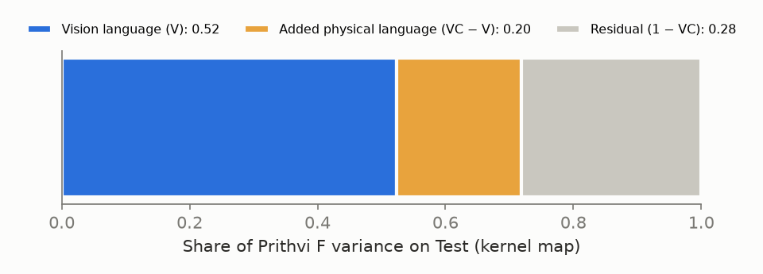
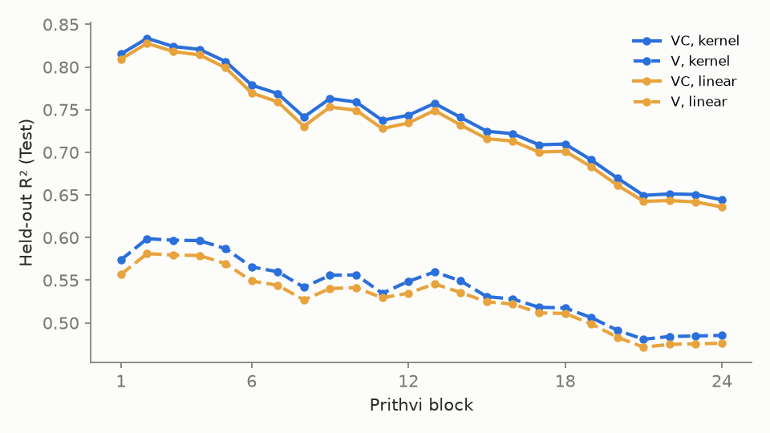
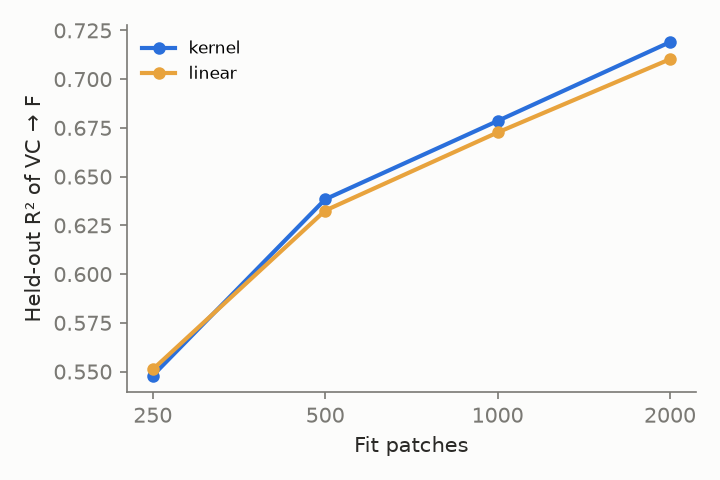

# VS: verbal share and residual of Prithvi (VS-0 to VS-3)

## Deviations

| ID | What | Why | Effect |
|---|---|---|---|
| VS-X1 (approved) | Caption budget raised from 1,000 / 1,500 to 3,000 tokens, with one retry at 4,500. Prompt, schema and decoding unchanged. | With the frozen prompt and schema, 6 of 8 smoke captions overran 1,500 tokens (median length about 1,600). | 17 Fit and 8 Test captions retried; 3 Fit and 3 Test dropped. Fit n = 1,997, Test n = 997. |
| VS-E1 (tried, reverted) | Forced compact JSON at the engine level. | vLLM 0.34 ignores the per-request whitespace flag. | Compact decoding made the model empty every array. Reverted before the design run. No design output used it. |
| Placement | All captions ran on A2. | B2 timed out on ssh again. | About 2 hours of captioning instead of about 1. |
| Speed fix (no change in results) | Kernel CV computes distances with BLAS instead of scipy `cdist`. | `cdist` is single-threaded. | On synthetic inputs the numbers matched and the run was 5 times faster. |

The code descriptions follow the frozen sentence template verbatim, so they read "83th percentile" and similar.

## Headlines

**H1.** The descriptions predict most of Prithvi on new patches.
- From the selected kernel map, the verbal share of F (blocks 6, 12, 18 and 24) is 0.52 [0.50, 0.55] from vision language (V) and 0.72 [0.70, 0.73] from vision plus physical language (VC). That leaves a 0.28 residual.
- The linear map scores almost the same (V 0.52, VC 0.71). The geometry is close to linear: the best nonlinear map gains only 0.006 to 0.009.
- The map-free check agrees: linear CKA 0.37 and RBF CKA 0.45, against 0.01 and 0.02 with the rows shuffled.

**H2.** Prithvi still adds beyond the priors.
- Over the 15 graded classes, adding F to VC raises probe AUC by 0.055 [0.049, 0.061].
- In F's coordinates, F scores 0.079 [0.070, 0.090] higher than F̂.
- For Q17 the gains are 0.160 [0.137, 0.182] and 0.200 [0.174, 0.228].
- Both lower bounds exceed 0 for the mean, for Q17 and for 14 of 15 classes. Urban fabric is the exception.

**H3.** The addition lives in the residual.
- AUC(R) has a lower bound above 0.5 on all 15 targets where H2 holds. The mean over classes is 0.77 [0.76, 0.78], and Q17 is 0.86 [0.84, 0.88].
- Part of R is map error, not content no description could carry; see "Reading the result".

## VS-2: verbal share

### Maps (Test R², 997 patches; CV R² on Fit, 1,997 patches)
| Text | Map | Test R² [95% CI] | CV R² (Fit) | Hyperparameters |
|---|---|---|---|---|
| V | linear (RidgeCV, per target) | 0.518 [0.488, 0.546] | 0.553 | n/a |
| V | kernel (RBF) | 0.524 [0.495, 0.552] | 0.559 | gamma 0.389, alpha 1 |
| V | kNN (cosine) | 0.444 [0.411, 0.477] | 0.495 | k 20 |
| VC | linear | 0.710 [0.694, 0.725] | 0.708 | n/a |
| **VC** | **kernel (selected)** | **0.719 [0.703, 0.734]** | **0.715** | gamma 0.185, alpha 0.1 |
| VC | kNN | 0.531 [0.501, 0.560] | 0.568 | k 20 |

- **Sanity check.** With the VC rows shuffled across Fit patches, the Test R² is −0.004 for the kernel map and 0.000 for the linear map.
- **Cross-fitted share on Fit** (the residual for the Fit probes): 0.715.

### Field table (verbal share of F from one field alone, Test R²)
| Field | Kernel | Linear |
|---|---|---|
| 1 global | 0.509 | 0.491 |
| 2 layout | 0.482 | 0.456 |
| 3 features | 0.356 | 0.345 |
| 4 spectral | 0.464 | 0.448 |
| 5 interpretation | 0.437 | 0.415 |
| 6 summary | 0.437 | 0.422 |
| **7 code** | **0.766** | **0.730** |

On its own, the code field (ten band statistics written as sentences) predicts more of F than VC does (0.766 against 0.719). In VC the code field is 1 of 7 equally weighted blocks, so the caption blocks dilute it. VC's 0.72 is therefore a loose lower bound on the share that language can carry.

### Layer curve

- Text predicts early blocks best. VC reaches 0.83 at block 2, falls to 0.74 by block 12, and ends at 0.64 at block 24. V falls from 0.60 to 0.48.
- The map-free check runs the other way. Linear CKA between VC and each block rises from 0.32 at block 1 to 0.45 at block 24, and RBF CKA rises from 0.42 to 0.50. Mutual 10-NN overlap stays flat at about 0.10, against 0.01 shuffled.
- Late blocks have fewer dominant directions, and those align with the text, but less of their total variance is predictable from it.

### Learning curve (VC → F, Test R²)

| Fit n | 250 | 500 | 1,000 | 2,000 |
|---|---|---|---|---|
| Kernel | 0.548 | 0.638 | 0.679 | 0.719 |
| Linear | 0.551 | 0.633 | 0.673 | 0.710 |

The curve still rises by about 0.04 per doubling at n = 2,000. More Fit data would raise the verbal share.

## VS-3: probes (Test AUC; true labels used only here)

The 15 graded classes are those with at least 20 positives in both Fit and Test. Q17 is the FB NDMI-residual key.

| Target | Test pos | V | VC | F | F̂ | R | VC+F | FM gain (VC+F − VC) | F − F̂ | Physical gain (VC − V) |
|---|---|---|---|---|---|---|---|---|---|---|
| Urban fabric | 96 | .869 | .870 | .915 | .891 | .651 | .882 | +.011 [−.002, .025] | +.024 [−.001, ·] | +.002 [−.008, .012] |
| Arable land | 420 | .814 | .836 | .921 | .866 | .672 | .870 | +.034 [.022, .046] | +.055 | +.022 [.011, .032] |
| Permanent crops | 34 | .744 | .813 | .926 | .860 | .769 | .864 | +.051 [.027, .078] | +.066 | +.069 [.027, .117] |
| Pastures | 217 | .782 | .820 | .927 | .847 | .766 | .880 | +.060 [.044, .077] | +.081 | +.038 [.023, .053] |
| Complex cultivation | 178 | .743 | .754 | .868 | .780 | .698 | .830 | +.076 [.054, .097] | +.088 | +.010 [−.006, .027] |
| Agriculture with natural vegetation | 236 | .670 | .677 | .829 | .717 | .684 | .748 | +.071 [.049, .093] | +.111 | +.006 [−.010, .023] |
| Agro-forestry | 78 | .814 | .935 | .981 | .946 | .910 | .966 | +.031 [.017, .048] | +.036 | +.122 [.087, .160] |
| Broad-leaved forest | 299 | .700 | .726 | .894 | .756 | .761 | .809 | +.083 [.065, .104] | +.137 | +.026 [.009, .043] |
| Coniferous forest | 322 | .788 | .844 | .945 | .863 | .821 | .917 | +.072 [.057, .088] | +.082 | +.056 [.037, .075] |
| Mixed forest | 365 | .745 | .778 | .904 | .824 | .733 | .854 | +.076 [.061, .091] | +.079 | +.033 [.019, .050] |
| Moors and heathland | 27 | .754 | .775 | .977 | .889 | .961 | .850 | +.076 [.039, .116] | +.088 | +.020 [−.010, .048] |
| Transitional woodland | 325 | .681 | .700 | .810 | .763 | .658 | .735 | +.035 [.023, .048] | +.047 | +.018 [.006, .030] |
| Inland wetlands | 31 | .599 | .648 | .913 | .691 | .866 | .750 | +.102 [.063, .141] | +.222 | +.048 [.005, .092] |
| Inland waters | 124 | .797 | .887 | .951 | .880 | .851 | .929 | +.043 [.029, .057] | +.071 | +.090 [.062, .122] |
| Marine waters | 99 | .990 | .996 | .999 | .996 | .750 | .999 | +.002 [.001, .004] | +.003 | +.006 [.002, .013] |
| **Mean of 15** | | **.766** | **.804** | **.917** | **.838** | **.770** | **.859** | **+.055 [.049, .061]** | **+.079 [.070, .090]** | **+.038 [.031, .045]** |
| **Q17** | 477 | .637 | .779 | .981 | .781 | .861 | .939 | **+.160 [.137, .182]** | **+.200 [.174, .228]** | **+.142 [.120, .164]** |

- In the F − F̂ column, a bracket shows a lower bound only where it decides H2. All of them are above 0 except urban fabric. Full intervals are in `vs3.json`.
- The bootstrap uses 1,000 paired resamples over Test patches.
- Every input is standardized, and each probe is a `LogisticRegressionCV` with Cs {0.01, 0.1, 1}.

## Reading the result
- **Language covers most of Prithvi, mostly through simple physics.** Six caption fields from a 9B VLM explain about half of F. Ten band statistics written as sentences explain three quarters. Captions add little once the code field is present; in this map the combination even scores below code alone.
- **The leftover still matters for labels.** F beats F̂ on 14 of 15 classes and on Q17.
  - The gap is largest where the captions are weakest: inland wetlands (+0.22), broad-leaved forest (+0.14), Q17 (+0.20).
  - It is near zero where pictures suffice: marine waters, urban fabric.
- **The residual is partly map error.** The learning curve is still rising, so part of R is variance a better map, or more Fit data, would move into F̂. AUC(R) above 0.5 shows the residual holds label signal. It does not show that no description could carry it.
- **The concatenated probe understates the gain.** VC + F scores below F alone (0.859 against 0.917). The joint input has 22,016 dimensions, one regularization strength, and only 1,997 examples, so the probe dilutes F's signal. The F − F̂ form avoids this and gives the larger gain.

## Files
- **Design and change log:** `DESIGN_VS_v1.md` (sha256 e0e36616…), `CHANGE_REQUEST_VS-X1.md` and `LOG.md`.
- **Scripts:** `scripts/vs_common.py`, `vs0_prepare.py`, `vs1.py`, `vs2_maps.py` and `vs3_probes.py`.
- **Prompt and schema:** `caption_prompt.txt` and `schemas/caption_vs.json`.
- **Data:** `sets.json`, `vs0.json`, `fields_{fit,test}.jsonl` (the 7 text fields and uncertainties), `vs2.json`, `vs3.json` and `figs/`.
- **Raw captions, features, embeddings and residuals:** `~/langres_state/vs/`.
